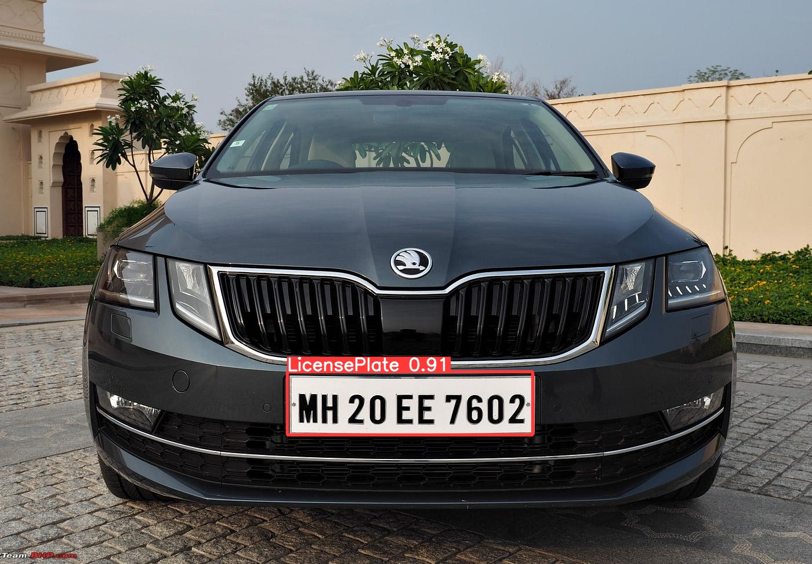
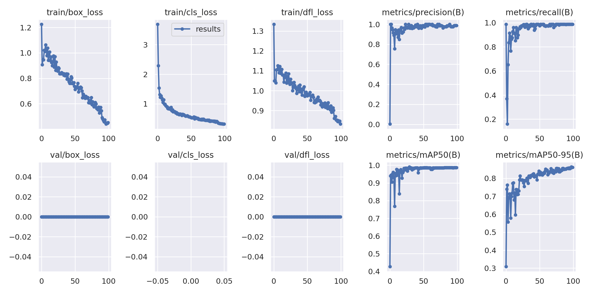

# 🚗 Licence Plate Recognition — YOLOv8 + EasyOCR

Système de **reconnaissance automatique de plaques d'immatriculation (ALPR)** :

1. **Détection** de la plaque sur l'image avec un modèle **YOLOv8n** entraîné sur un dataset Roboflow ;
2. **Lecture** du texte de la plaque avec **EasyOCR** ;
3. **Contrôle d'accès** : vérification de la plaque dans une base **SQLite** des véhicules autorisés.

<p align="center">
  
</p>

## 📊 Résultats

Modèle entraîné 100 epochs (YOLOv8n, images 640×640, batch 16) :

| Précision | Rappel | mAP@50 | mAP@50-95 |
|:---:|:---:|:---:|:---:|
| 0.987 | 0.988 | 0.987 | 0.862 |

<p align="center">
  
</p>

Autres courbes (matrice de confusion, PR, F1) dans [`docs/training/`](docs/training).

## 📁 Structure du projet

```
├── assets/                     # Images et vidéo de démonstration
├── data/
│   └── license-plate-detector/ # Dataset Roboflow (train / valid / test + data.yaml)
├── database/
│   ├── alpr.db                 # Base SQLite des plaques autorisées
│   └── schema.sql              # Schéma de la table `immatriculations`
├── docs/training/              # Métriques et courbes de l'entraînement
├── notebooks/
│   └── ALPR.ipynb              # Notebook Google Colab (détection → OCR → accès)
├── src/
│   ├── predict_with_ocr.py     # Détection YOLOv8 + lecture EasyOCR
│   └── access_control.py       # Vérification d'accès dans la base
├── ultralytics/                # Ultralytics 8.0.3 (version utilisée par les scripts)
├── weights/
│   └── best.pt                 # Poids du modèle entraîné
└── requirements.txt
```

## ⚙️ Installation

```bash
git clone https://github.com/mohammedbasbas/Licence-Plate-Recognition-using-YOLO-V8.git
cd Licence-Plate-Recognition-using-YOLO-V8
pip install -r requirements.txt
```

> Les scripts reposent sur l'API d'**Ultralytics 8.0.3** (`ultralytics.yolo...`), incluse dans le dépôt. Les versions récentes d'Ultralytics ne sont pas compatibles.

## 🚀 Utilisation

Toutes les commandes se lancent depuis la racine du dépôt.

**Détection + lecture de la plaque**

```bash
python src/predict_with_ocr.py model=weights/best.pt source=assets/sample_car.jpg
```

L'image annotée (avec le texte lu) est enregistrée dans `runs/detect/`, et le texte est affiché dans la console (`OCR Results: [...]`). `source` accepte aussi une vidéo, un dossier ou une webcam (`source=0`).

**Contrôle d'accès**

```bash
# à partir d'une image (détection + OCR + vérification)
python src/access_control.py --image assets/sample_car.jpg

# ou directement à partir d'un numéro de plaque
python src/access_control.py "MH 20 EE 7602"
```

**Ré-entraîner le modèle**

```bash
yolo task=detect mode=train model=yolov8n.pt data=data/license-plate-detector/data.yaml epochs=100 imgsz=640
```

**Google Colab** : ouvrez [`notebooks/ALPR.ipynb`](notebooks/ALPR.ipynb) après avoir copié le dossier du projet dans `MyDrive/Licence-Plate-Detection-using-YOLO-V8`.

## 🗃️ Base de données

Table `immatriculations` :

| Colonne | Type | Description |
|---|---|---|
| `id` | INTEGER | Clé primaire |
| `nom_proprietaire` | TEXT | Nom du propriétaire |
| `immatriculation` | TEXT (unique) | Numéro de plaque autorisé |

Ajouter un véhicule autorisé :

```bash
sqlite3 database/alpr.db "INSERT INTO immatriculations (nom_proprietaire, immatriculation) VALUES ('Nom', 'AB 12 CD 3456');"
```

## 🧰 Technologies

Python · YOLOv8 (Ultralytics) · PyTorch · EasyOCR · OpenCV · SQLite · Google Colab

## 📄 Crédits

- Dataset : [License Plate Detector v2](https://universe.roboflow.com/snu-i6ovv/license-plate-detector-ogxxg/dataset/2) (Roboflow, licence CC BY 4.0)
- [Ultralytics YOLOv8](https://github.com/ultralytics/ultralytics) (GPL-3.0)
- [EasyOCR](https://github.com/JaidedAI/EasyOCR)

## 👤 Auteur

**Mohammed Basbas** — [@mohammedbasbas](https://github.com/mohammedbasbas)
